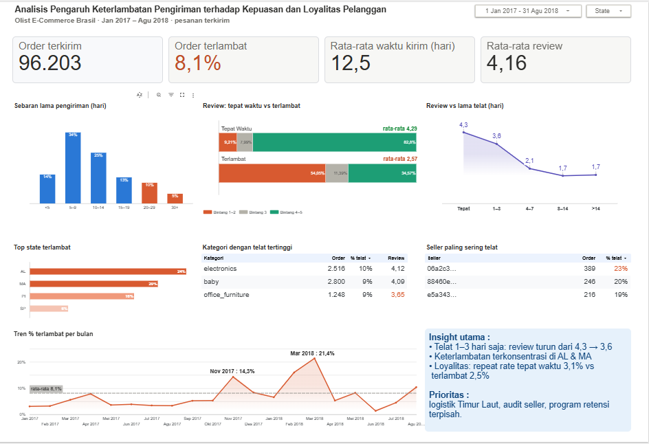
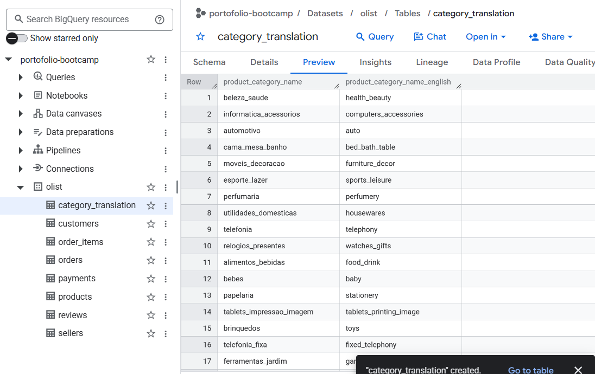
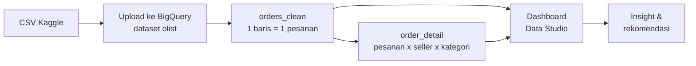

# Analisis Pengaruh Keterlambatan Pengiriman terhadap Kepuasan dan Loyalitas Pelanggan

**Delivery Performance & Customer Retention Analytics · Olist E-Commerce Brasil (Jan 2017 – Agu 2018)**



🔗 **[Dashboard interaktif (Data Studio)](https://datastudio.google.com/reporting/96d1e152-12a7-45a5-8b3b-7c0871c630c4)** · 📄 **[Deck portofolio (PDF)](deck/Portofolio_Olist_Cintya_Poppy_Miranda.pdf)**

🛠️ **Tools:** Google BigQuery (SQL) · Data Studio (dulu Looker Studio)

---

## Ringkasan

- **8,1%** dari 96.203 pesanan terkirim tiba **lebih lambat dari estimasi**. Rata-rata waktu kirim **12,5 hari**.
- Pesanan terlambat mendapat review jauh lebih buruk: **4,29 → 2,57**. Telat **1–3 hari saja** sudah menurunkan review dari 4,3 ke 3,6.
- Keterlambatan terpusat di **Timur Laut Brasil** (AL 24%, MA 20%, PI 16% vs SP 6%), pada beberapa seller, dan memuncak di **Nov 2017** serta **Feb–Mar 2018**.
- Pelanggan yang pesanan pertamanya terlambat **lebih jarang belanja lagi** (repeat rate 2,54% vs 3,07%).

---

## 1. Latar belakang & pertanyaan bisnis

Olist adalah platform e-commerce Brasil yang menghubungkan toko-toko kecil dengan pembeli melalui marketplace. Pengiriman ditangani mitra logistik, sehingga ketepatan waktu kirim sangat menentukan pengalaman pelanggan.

Proyek ini mengukur seberapa besar masalah keterlambatan, dampaknya pada review dan pembelian ulang, serta di mana dan kapan masalah terjadi.

| # | Pertanyaan bisnis | Dijawab oleh |
|---|---|---|
| 1 | Seberapa besar masalah keterlambatan? | KPI, sebaran lama pengiriman |
| 2 | Seberapa besar dampaknya ke kepuasan (review)? | Review tepat waktu vs terlambat, review vs lama telat |
| 3 | Di mana dan kapan keterlambatan terjadi? | Top state, kategori, seller, tren bulanan |
| 4 | Apakah keterlambatan menurunkan loyalitas? | Repeat rate berdasarkan pesanan pertama |

---

## 2. Dataset

Sumber: [Brazilian E-Commerce Public Dataset by Olist (Kaggle)](https://www.kaggle.com/datasets/olistbr/brazilian-ecommerce), ±100 ribu pesanan, 2016–2018.

8 dari 9 file CSV diunggah ke BigQuery Sandbox (project `portofolio-bootcamp`, dataset `olist`). File geolocation tidak dipakai.

| Tabel | Baris | Dipakai untuk |
|---|---:|---|
| `orders` | 99.441 | status, tanggal pesan, tiba, dan estimasi |
| `customers` | 99.441 | state pelanggan, `customer_unique_id` (loyalitas) |
| `order_items` | 112.650 | penghubung pesanan → produk → seller |
| `payments` | 103.886 | (diunggah, tidak dipakai di analisis ini) |
| `reviews` | 99.224 | skor review 1–5 |
| `products` | 32.951 | kategori produk |
| `sellers` | 3.095 | data seller |
| `category_translation` | 71 | nama kategori Portugis → Inggris |



---

## 3. Alur pengerjaan



| Tahap | Isi | File |
|---|---|---|
| Cek tabel | Jumlah baris & tipe data setelah upload | [`sql/01_cek_tabel.sql`](sql/01_cek_tabel.sql) |
| Data understanding | Profiling data & alasan setiap aturan cleaning | [`sql/02_data_understanding.sql`](sql/02_data_understanding.sql) |
| Data cleaning & preparation | Membuat tabel `orders_clean` dan `order_detail` | [`sql/03_data_cleaning.sql`](sql/03_data_cleaning.sql) |
| Analisis | Query untuk setiap pertanyaan bisnis + angka hasil | [`sql/04_analysis.sql`](sql/04_analysis.sql) |

### Aturan cleaning

| Aturan | Alasan |
|---|---|
| Periode pesanan 1 Jan 2017 – 31 Agu 2018 | Data sebelum 2017 dan setelah Agu 2018 sangat sedikit |
| Buang status `canceled` & `unavailable` | Pesanan tidak pernah dikirim |
| Keterlambatan hanya dihitung untuk pesanan terkirim | Pesanan yang belum tiba tidak punya tanggal terima |
| 1 review per pesanan (yang terbaru) | Sebagian pesanan punya lebih dari 1 review; tanpa ini baris akan dobel |
| Loyalitas memakai `customer_unique_id` | `customer_id` selalu baru di setiap pesanan |

### Definisi metrik

| Kolom | Definisi |
|---|---|
| `late_flag` | 1 jika tanggal tiba > tanggal estimasi, 0 jika tidak, NULL jika belum terkirim |
| `delivery_days` | Lama kirim dari waktu pesan sampai diterima (jam ÷ 24) |
| `late_days` | Selisih hari kalender antara tanggal tiba dan tanggal estimasi |
| `pelanggan_kembali` | TRUE jika pelanggan punya lebih dari 1 pesanan di periode analisis |

> Tanggal estimasi Olist selalu pukul 00:00. Dengan perbandingan timestamp, pesanan yang tiba di hari estimasi ikut terhitung terlambat, sehingga hasilnya **8,1%**. Jika hanya membandingkan tanggal, angkanya sekitar 6,8%. Kesimpulan analisis tidak berubah.

---

## 4. Dashboard

Dashboard disusun dalam 4 baris yang membentuk alur cerita:

| Baris | Isi | Sumber data |
|---|---|---|
| 1 · KPI | Pesanan terkirim, % terlambat, rata-rata waktu kirim, rata-rata review | `orders_clean` |
| 2 · Besar masalah & dampak | Sebaran lama pengiriman, review tepat waktu vs terlambat, review vs lama telat | `orders_clean` |
| 3 · Di mana | Top state terlambat, kategori dan seller dengan % telat tertinggi | `orders_clean`, `order_detail` |
| 4 · Kapan & kesimpulan | Tren % terlambat per bulan, kotak insight utama | `orders_clean` |

Filter interaktif: **rentang tanggal** dan **state**.

---

## 5. Hasil & insight

| Metrik | Nilai |
|---|---|
| Pesanan terkirim | 96.203 |
| Pesanan terlambat | 8,1% |
| Rata-rata waktu kirim | 12,5 hari |
| Rata-rata review | 4,16 |

**1. Pesanan terlambat mendapat review jauh lebih buruk.** 54% pesanan terlambat diberi bintang 1–2, dibanding 9% pesanan tepat waktu. Porsi bintang 4–5 turun dari 83% ke 35%. Rata-rata review turun dari **4,29 ke 2,57**.

**2. Telat sebentar pun sudah berdampak.** Review turun dari 4,3 ke **3,6** hanya karena telat 1–3 hari, lalu ke 2,1 saat telat 4–7 hari. Setelah lebih dari seminggu, review tertahan di sekitar 1,7.

**3. Ada ekor panjang waktu kirim.** 59% pesanan tiba dalam 5–14 hari, tetapi **15% pesanan butuh 20 hari atau lebih**.

**4. Masalah terpusat di wilayah & seller tertentu.** AL (24%), MA (20%), dan PI (16%) jauh di atas SP (6%), state dengan volume terbesar. Tiga seller dengan minimal 200 pesanan terlambat pada 19–23% pesanannya. Kategori `office_furniture` punya review terendah (3,65) di antara kategori besar.

| Kategori (≥ 1.000 pesanan) | Pesanan | % telat | Review |
|---|---:|---:|---:|
| electronics | 2.516 | 10% | 4,12 |
| baby | 2.800 | 9% | 4,09 |
| office_furniture | 1.248 | 9% | 3,65 |

**5. Keterlambatan bersifat musiman.** Puncak terjadi di **Nov 2017 (14,3%)**, bertepatan dengan Black Friday, dan **Feb–Mar 2018 (16,0% → 21,4%)**, lebih dari dua kali rata-rata 8,1%.

**6. Loyalitas ikut turun.** Repeat rate pelanggan yang pesanan pertamanya tepat waktu **3,07%**, dibanding **2,54%** bila pesanan pertamanya terlambat (≈17% lebih rendah). Repeat rate Olist secara umum memang rendah (±3%), jadi loyalitas juga perlu program tersendiri.

---

## 6. Rekomendasi

1. **Logistik Timur Laut:** mitra logistik atau gudang regional untuk AL, MA, dan PI, serta estimasi tiba yang lebih realistis per wilayah.
2. **Audit seller & kategori:** pantau seller dengan % telat ≥ 18% dan kategori seperti `office_furniture`; tetapkan SLA pengiriman.
3. **Komunikasi proaktif:** notifikasi dan voucher kompensasi sejak hari pertama keterlambatan, karena telat 1–3 hari pun sudah menurunkan review.
4. **Retensi & musim ramai:** program pembelian kedua untuk menaikkan repeat rate, dan tambah kapasitas pengiriman sebelum Black Friday serta Feb–Mar.

---

## 7. Keterbatasan

- Analisis bersifat korelasional, bukan kausal. Faktor lain seperti kualitas produk dan harga juga memengaruhi review.
- Dataset adalah sampel publik Olist; nama seller dan produk dianonimkan.
- Repeat rate dihitung dalam jendela 20 bulan, sehingga pelanggan yang pertama kali belanja di akhir periode punya waktu lebih sedikit untuk kembali.

---

## 8. Struktur repository

```
olist-delivery-impact-analysis/
├── README.md
├── sql/
│   ├── 01_cek_tabel.sql            # validasi upload: jumlah baris & tipe data
│   ├── 02_data_understanding.sql   # profiling data & alasan cleaning
│   ├── 03_data_cleaning.sql        # CREATE TABLE orders_clean & order_detail
│   └── 04_analysis.sql             # query analisis + angka hasil
├── images/
│   ├── dashboard.png           # screenshot dashboard Data Studio
│   └── bigquery_dataset.png    # tabel di BigQuery
└── deck/
    └── Portofolio_Olist_Cintya_Poppy_Miranda.pdf
```

**Cara menjalankan ulang:** unduh dataset dari Kaggle, unggah CSV ke BigQuery dalam dataset bernama `olist`, lalu jalankan file SQL sesuai urutan nomor.

---

Dibuat oleh **Cintya Poppy Miranda** sebagai project akhir Bootcamp Data Analyst with SQL & Python in Google Platform (DQLab, Batch 25).
